# Cosmic Atlas

**A 3D map of the real universe in your browser, from Earth to the cosmic web, built only from open survey data.**

**[Open the atlas →](https://ismoilovdevml.github.io/cosmic-atlas/)**

[](https://doi.org/10.5281/zenodo.24224239)

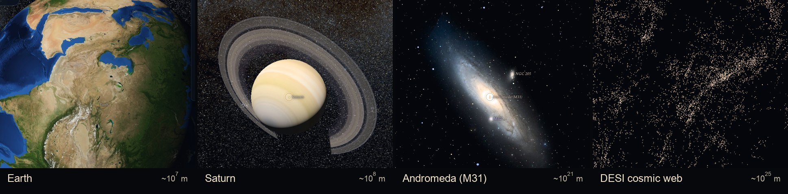

Fly from your own planet past Saturn, out of the Milky Way, past Andromeda and into the web of
15 million galaxies mapped by DESI. Every point is a real object at its measured position. Every
number on screen comes with the catalogue it came from.

## What you can do

- **Fly across 19 orders of magnitude** in one continuous scene, from planet surfaces (10⁷ m) to
  billions of light-years (10²⁶ m). Scroll to zoom, drag to turn, or take the guided scale tour.
- **Search for anything**: a planet, a star, a galaxy, a black hole or an exoplanet. The camera
  flies there.
- **Click any object** for its distance, size and other facts, with the source and links to
  SIMBAD, Gaia and the DESI viewer.
- **See the uncertainty.** Distances are measurements, and the atlas shows each object's 16–84 %
  range.
- **Watch the Solar System move** in real time, or run time forward ×10⁴ or ×10⁶: 1.58 million
  asteroids, comets and 16,896 satellites follow their real orbits.
- **Land on the Moon and Mars.** NASA surface imagery streams in as you descend, with named
  craters, valleys and 21 landing sites.
- **Move the stars in time**, up to a million years either way, along their measured Gaia
  velocities.
- **Show me**: fly from the cosmic web down to the place where you are. Your location stays in
  the browser and is never sent or stored.
- **Visit a black hole.** The light around Sgr A*, M87* and Gaia BH3 is ray-traced in general
  relativity, and a live readout shows how time slows and tides grow as you approach.
- **Read about anything.** Every object links to a short article, in Uzbek, English or Russian.
- **Share a view.** The link names the object you are looking at, e.g. `#at=Saturn`.

## What's in it

| | Objects | Source |
|---|---|---|
| Solar System | Sun, 8 planets, Pluto, the Moon, major moons, 5 interstellar probes | astronomy-engine (VSOP87, checked against JPL Horizons), JPL Horizons |
| Asteroids and comets | 1,580,450 asteroids and 4,666 comets on their orbits | IAU Minor Planet Center |
| Earth satellites | 16,896, plus JWST | CelesTrak (SGP4), JPL Horizons |
| Moon and Mars surfaces | 861 named features, 21 landing sites, streamed surface imagery | NASA Moon/Mars Trek (LRO, Viking, MRO CTX), IAU Gazetteer |
| Stars | Gaia DR3 within 100 pc now, within 1 kpc *(being added)*; 653 named stars | ESA Gaia, Bailer-Jones et al. 2021, IAU |
| Star clusters | 7,181 star clusters | Hunt & Reffert 2023/24, Baumgardt |
| Exoplanets | 6,442 planets in 4,834 systems | NASA Exoplanet Archive |
| Pulsars | 4,429 | ATNF Pulsar Catalogue |
| Black holes | 40, from Sgr A* and M87* to Gaia BH3 | GRAVITY, EHT, Gaia, BlackCAT |
| Nebulae and supernova remnants | 421 + 312 | OpenNGC, Green 2024 |
| Nearby galaxies | Local Group, Local Volume, 1,016 with real shapes and images | McConnachie, UNGC, HyperLEDA, DSS2 |
| Distant galaxies | 15,140,002 galaxies and quasars | DESI DR1 |
| All-sky galaxies | 43,463 + 55,877 | 2MRS, Cosmicflows-4 |
| Messages to the stars | Arecibo 1974 and 30 more, plus the Wow! signal | cited per entry |
| Interstellar dust | 3D dust clouds within 1.25 kpc (6 pc grid), dark in front of the stars, a glow from outside | Edenhofer et al. 2024 |
| Gravitational waves | 282 merger events with their 90 % localisation volumes | LIGO/Virgo/KAGRA GWTC via GWOSC |
| Fast radio bursts | 3,661 bursts on the sky, 101 with a host galaxy | CHIME/FRB Catalog 2, FRB host repository |
| Neutrinos | 349 IceCube alerts with error regions, 2 identified sources, KM3-230213A | IceCat-1, KM3NeT |
| Sky backgrounds | Gaia (visible), eROSITA (X-ray), Planck 857 GHz (dust) | ESA, MPE, Planck |
| Cosmic microwave background | The Planck map as the edge of the observable universe, 13.8 billion years old light | Planck PR3 |

## Screenshots

| | |
|---|---|
| 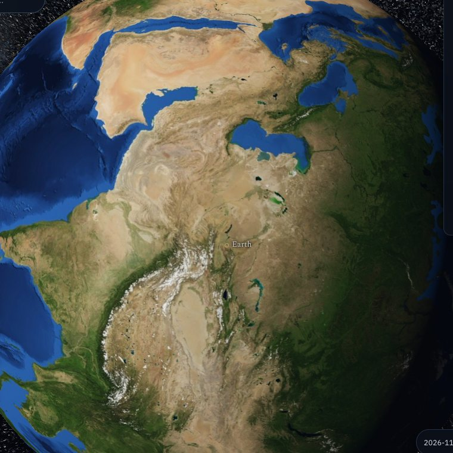 | 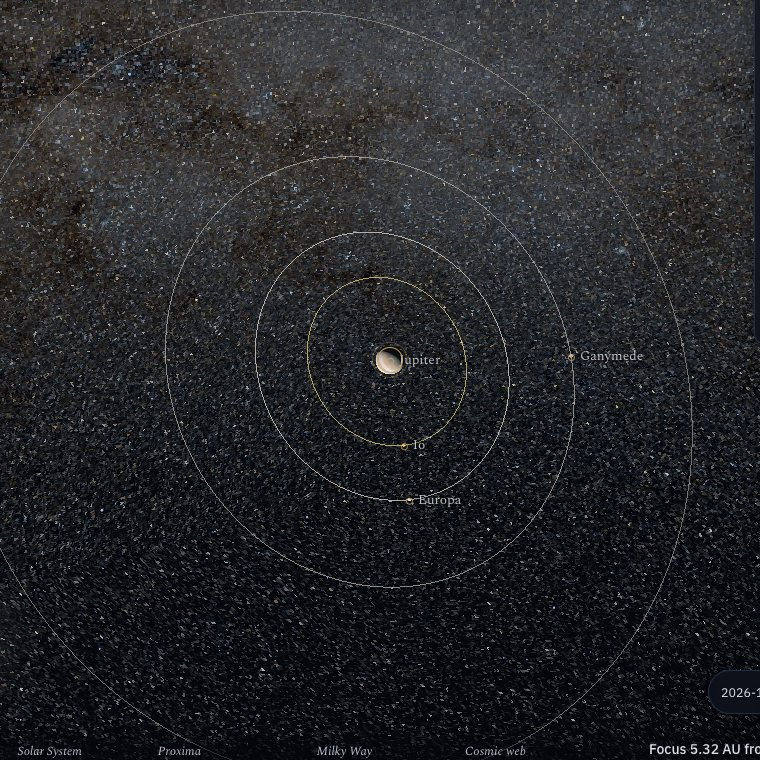 |
| **Earth**, with day and night at the current time | **Jupiter** and its moons on their real orbits |
| 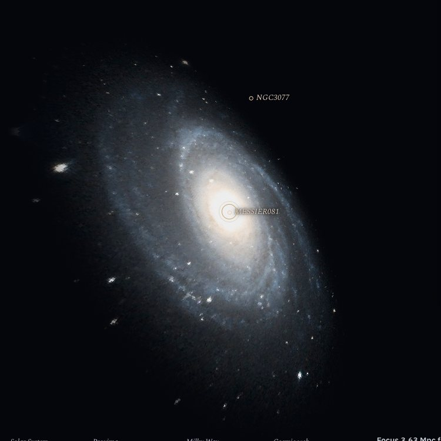 | 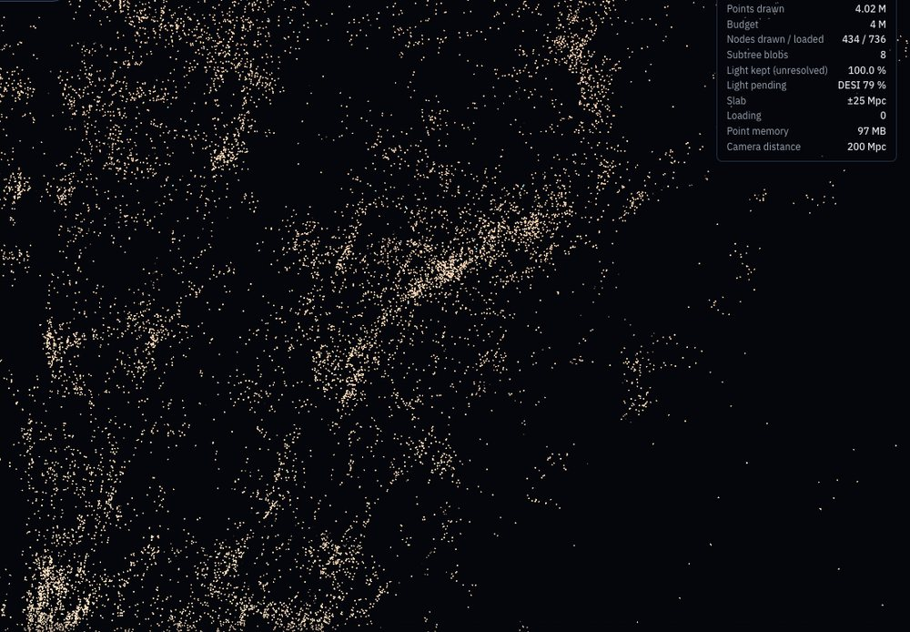 |
| **M81**, with size and tilt from HyperLEDA | **The cosmic web**: DESI galaxies in a 50 Mpc slice |
| 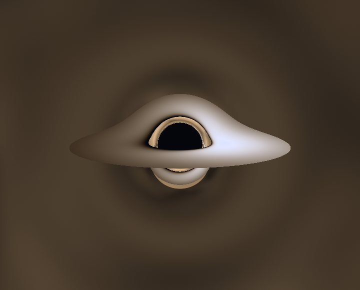 | 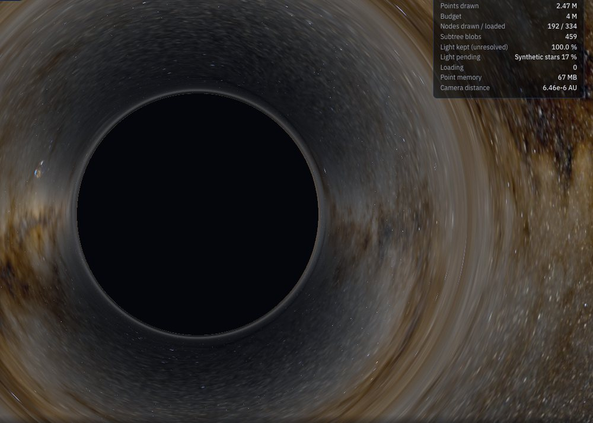 |
| **Sgr A\***: the far side of the disk is bent over the shadow | **Gaia BH3** bends the real Milky Way around it |
| 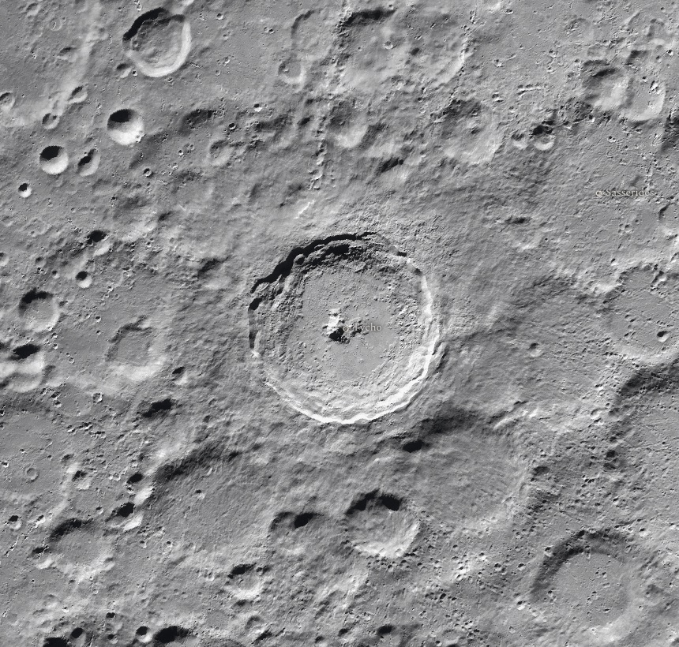 | 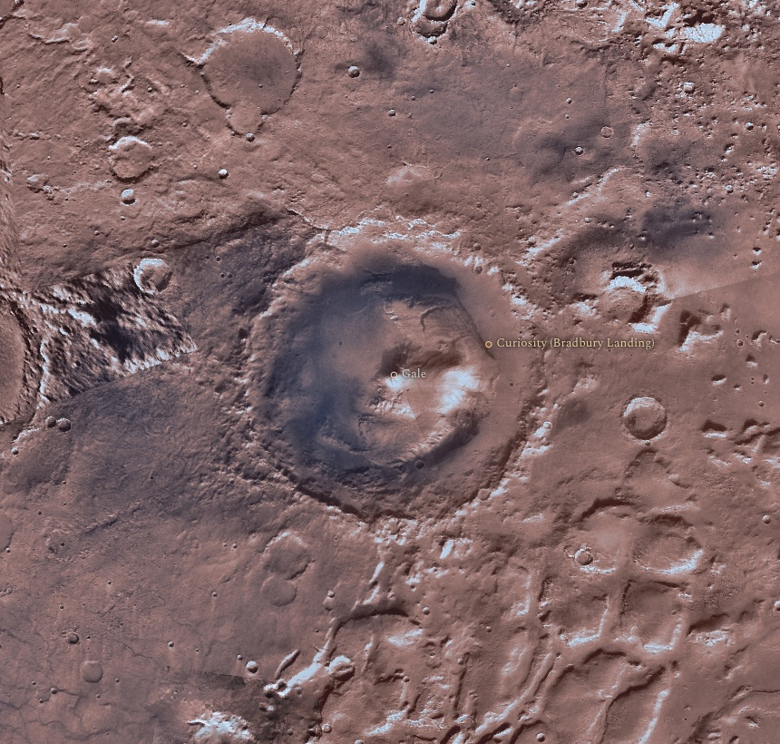 |
| **Tycho** on the Moon, NASA LRO imagery | **Gale crater** on Mars, where Curiosity landed |
| 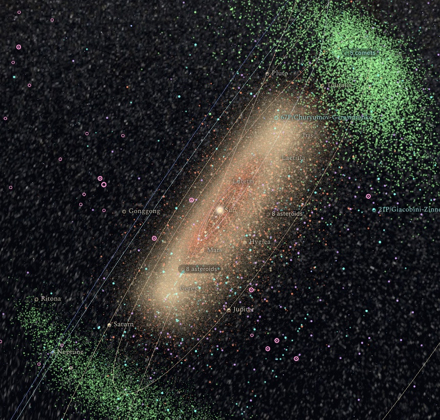 | 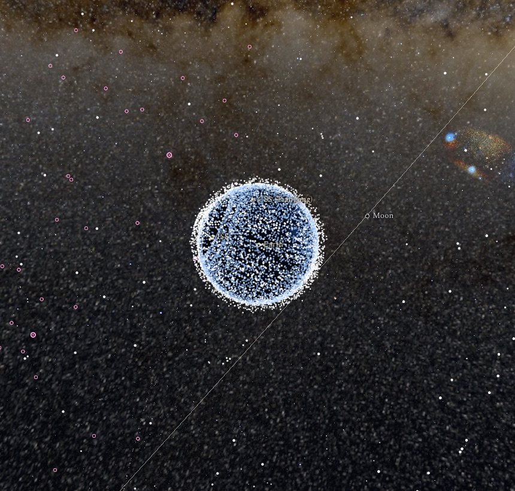 |
| **The asteroid belt** and Jupiter's two Trojan swarms | **Earth** inside its shell of satellites |
| 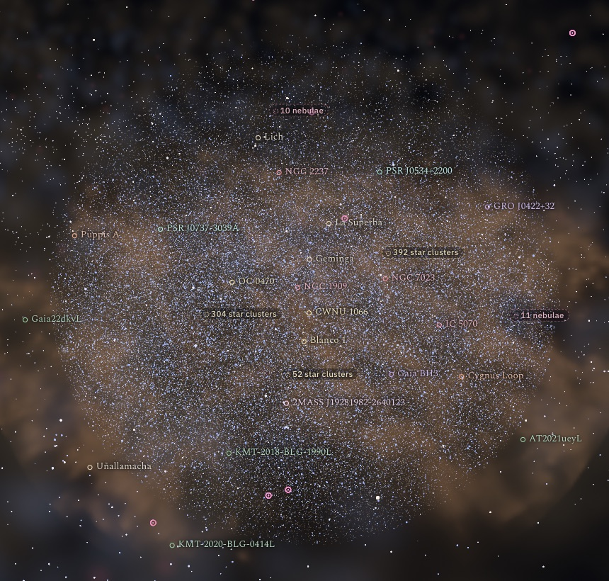 | 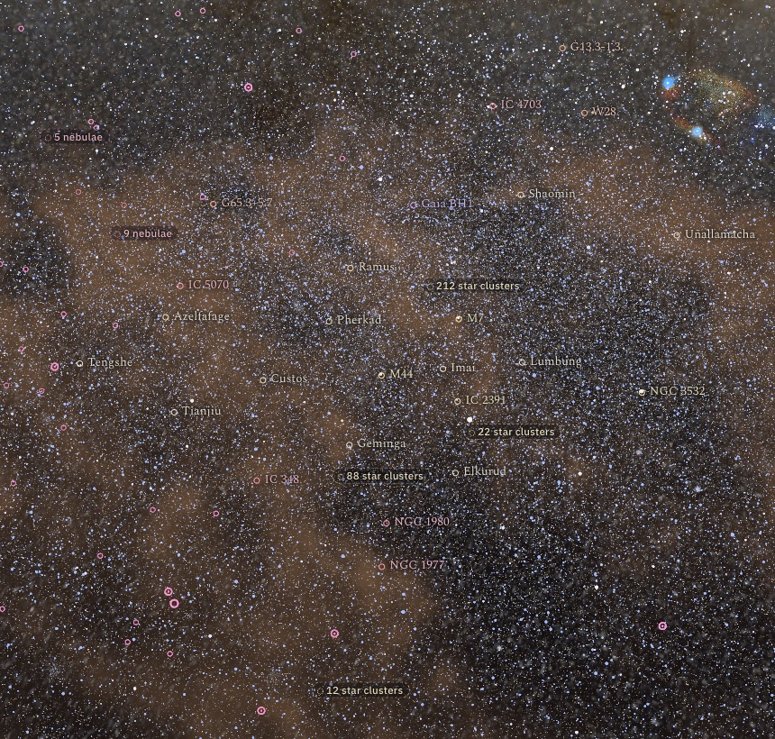 |
| **3D dust** around the Sun, seen from 2.6 kpc | **Star clusters** in the Milky Way's disk |

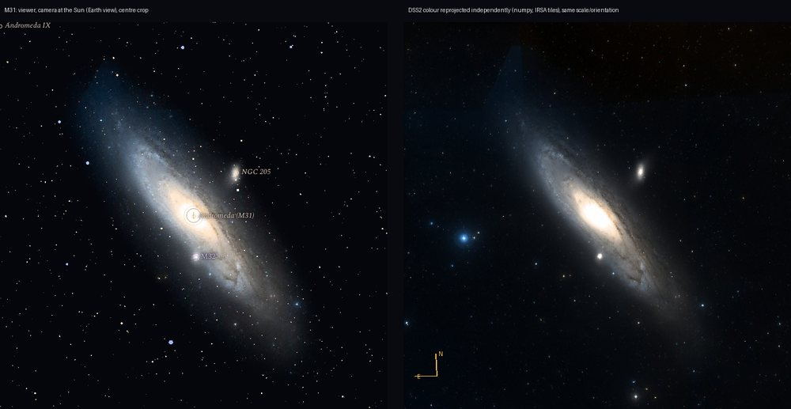
*Accuracy check: Andromeda in the atlas (left) next to an independent reprojection of the
Digitized Sky Survey image (right). Size, angle and satellite galaxies match.*

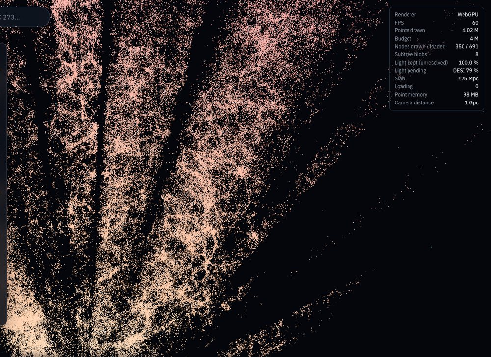
*DESI DR1 out to a billion parsecs. The dark wedges are parts of the sky the survey has not
observed.*

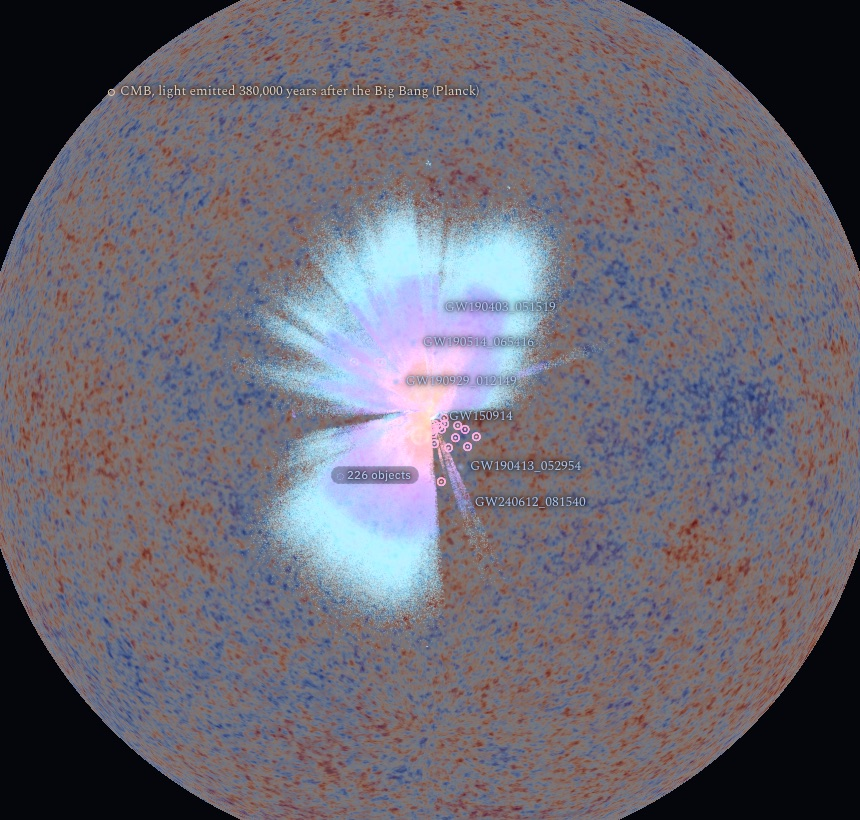
*The edge of the map: the Planck cosmic microwave background, drawn as a shell around every galaxy
survey.*

## Run it locally

```bash
git clone https://github.com/ismoilovdevml/cosmic-atlas && cd cosmic-atlas/web
npm ci
npm run dev        # http://localhost:5173
```

The repository holds the code and the small catalogues. The large point layers (Gaia, DESI) are
built from the original archives with the scripts in `scripts/` and `pipeline/`; see
[docs/data-contract.md](docs/data-contract.md). The web tile set is archived on Zenodo:
[10.5281/zenodo.24226088](https://doi.org/10.5281/zenodo.24226088). To publish your own copy, see
[docs/deploy.md](docs/deploy.md).

## How it works

- **Rendering**: WebGPU through three.js, with a WebGL2 fallback. Camera maths runs in float64,
  so one scene holds a planet and a galaxy cluster without jitter.
- **Streaming**: every large layer is an octree of small binary tiles. The browser loads only
  what is on screen, up to a point budget, and draws regions that aren't loaded yet as their
  total light.
- **Science first**: Planck18 cosmology, Bailer-Jones distances for Gaia stars, IAU radii, and a
  cited source for every number. Each catalogue has a re-runnable script and a `PROVENANCE.json`
  with its query, date and citation.

More detail: [web/README.md](web/README.md) (the viewer), [docs/prior-work.md](docs/prior-work.md)
(other projects and how this one differs), [docs/content-contract.md](docs/content-contract.md)
(object types and in-app articles).

## Credits

- **Data:** ESA/Gaia/DPAC, the DESI Collaboration, NASA Exoplanet Archive, ATNF, JPL, 2MRS,
  Cosmicflows-4, HyperLEDA, the IAU Minor Planet Center, CelesTrak, NASA Trek, LIGO/Virgo/KAGRA,
  CHIME/FRB, IceCube, KM3NeT, eROSITA-DE, Planck, CDS (SIMBAD, VizieR, HiPS), OpenNGC (CC BY-SA 4.0; our derived NGC
  catalogues carry the same licence), and every paper cited in the
  catalogues.
- **Images:** NASA Blue Marble and Black Marble 2016 night lights (public domain), Solar System
  Scope textures (CC BY 4.0), DSS2
  colour via CDS and IRSA.
- **Rendering ideas:** learned from [skymap](https://github.com/rulkens/skymap) (MIT,
  © 2026 Alexander Rulkens) and re-implemented.

## License

The code is [MIT](LICENSE). The data keeps its own licences. Gaia is **CC BY-NC 3.0 IGO**, so
this project is non-commercial. DESI DR1 is CC BY 4.0. The others are listed in each layer's
`PROVENANCE.json`.
