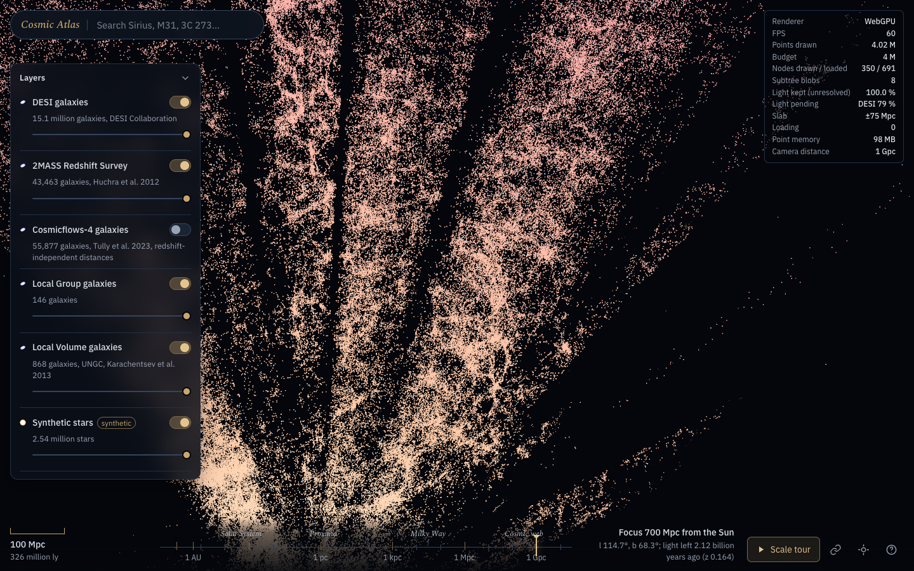

# Cosmic Atlas

A browser 3D map of the universe built only from public survey data. One continuous scene
covers the Sun and the nearest stars, the Gaia stars out to 1 kpc, the Milky Way, the Local
Group and Local Volume, and the DESI cosmic web out to z ≈ 7. It has search, layers, a
scale tour, and deep links to any object.



## What it does differently

Several maps already fly from the Solar System to the cosmic web. The closest are
[skymap](https://github.com/rulkens/skymap) (MIT, WebGPU), Space Time and Lightcone; the full
survey is in [docs/prior-work.md](docs/prior-work.md). What this project adds:

- **Full catalogues, streamed.** All 15.1 M DESI DR1 objects that pass the confident-redshift
  cuts, and tens of millions of Gaia stars. Neither is curated down to a few million points.
  Each layer is an additive-LOD octree, and the viewer streams nodes under a global point budget.
- **Distance uncertainty.** Every point carries its 16th/84th percentile distance. The info
  card shows the range, a selected object gets a 3D line-of-sight error bar, and a display mode
  stretches points along the line of sight by their error.
- **Honest light.** A subtree that isn't loaded is drawn as one blob only while it is smaller
  than about 6 px. Larger unresolved light is reported as "pending", never smeared. Brightness
  is per unit solid angle, so it doesn't depend on canvas size or field of view.
- **Provenance.** Each layer has a re-runnable fetch script and a `PROVENANCE.json` with the
  query, service, UTC time, row counts, cuts and citations.
- **Correct cosmology.** Planck18 comoving distances throughout. Galaxy brightness uses the
  luminosity distance, and lookback times are exact.

Rendering is WebGPU-first: three.js `three/webgpu` with TSL materials, falling back to WebGL2
automatically on browsers without WebGPU.

## Layers (v1)

| Layer | Objects | Source | Distances |
|---|---|---|---|
| `stars-gaia` | Gaia DR3, d < 1 kpc, parallax S/N > 10, RUWE < 1.4 | ESA Gaia archive TAP | Bailer-Jones et al. 2021 geometric |
| `stars-bright` | Hipparcos stars too bright for Gaia | VizieR I/311 | 1/parallax |
| `galaxies-desi` | 15,140,002 (13.56 M galaxies, 1.58 M QSOs) | DESI DR1 via Astro Data Lab TAP | Planck18 comoving from z |
| `galaxies-2mrs` | 43,463 | 2MRS (Huchra et al. 2012) | Planck18 from cz; redshift-independent below z = 0.003 |
| `galaxies-cf4` | 55,877 | Cosmicflows-4 (Tully et al. 2023) | redshift-independent |
| `local-group` | 146 | McConnachie 2012, 2021 update | distance moduli |
| `local-volume` | 868 | UNGC (Karachentsev et al. 2013) | redshift-independent where available |
| catalogues | 653 IAU star names, 588 Messier/NGC/IC | IAU WGSN list, OpenNGC, SIMBAD | see each entry's `ref` |
| Milky Way model | spiral arms, bar, disc | Reid et al. 2019; R0 = 8275 pc (GRAVITY 2021) | a model, labelled as one |
| sky sphere | Gaia DR3 integrated flux | ESA/Gaia/DPAC | background beyond 1 kpc |

## Live

- **https://ismoilovdevml.github.io/cosmic-atlas/** (GitHub Pages, primary): galaxy layers; Gaia stars are
  added when the download finishes.
- https://cosmic-atlas-axd.pages.dev (Cloudflare Pages mirror). Measured 2026-11-13 from Uzbekistan it was served
  from the Warsaw edge at 10–65 KB/s, against 0.3–2.7 MB/s from GitHub Pages, so it is not the primary.

GitHub Pages is rebuilt by `.github/workflows/pages.yml`; the Cloudflare mirror by `deploy/cloudflare_pages.sh`.

## Reproduce

```bash
uv venv --python 3.12 .venv
uv pip install --python .venv numpy pandas pyarrow astropy astroquery pyvo requests pytest

.venv/bin/python scripts/fetch_gaia.py all            # resumable; hours on the anonymous ESA TAP
.venv/bin/python scripts/fetch_desi.py
.venv/bin/python scripts/fetch_local_universe.py
.venv/bin/python scripts/build_named.py
.venv/bin/python scripts/validate_layers.py           # landmark checks, exit 1 on failure

scripts/build_all_tiles.sh                            # data/raw -> data/tiles
.venv/bin/python -m pytest tests                      # tile builder tests

cd web && npm ci && npm run dev                       # http://localhost:5173
```

`data/raw/` and `data/tiles/` are gitignored. Raw data is about 7 GB and the tiles about 2 GB.
The small named-object catalogues in `data/tiles/catalogs/` are committed.

## Deploy

The viewer is a static site: `npm run build` writes `web/dist/` (about 6 MB, most of it the Gaia
sky image). The tiles are separate and live at a **tile origin**:

- `VITE_TILE_BASE` at build time (absolute URL or relative path, default `tiles/` next to the page),
- or `?tiles=<url>` in the page URL, for testing (http/https and relative paths only),
- or `tilesBase` in `web/public/layers.json`.

Every tile, `meta.json`, catalogue and `_index.json` request goes to that origin as a plain CORS
`GET`, with no credentials and no custom headers, so there is no preflight. Any origin that sends
`Access-Control-Allow-Origin` works. JSON may come back as `text/plain`, as Hugging Face serves it.

Two scripts prepare a tile set for a static host:

```bash
# pruned copy under a byte budget (1 MB = 10^6 B); refuses any file > 95 MB, never splits files
.venv/bin/python scripts/make_lite_tiles.py /path/to/lite --budget-mb 900 \
    [--weight galaxies-desi=2] [--exclude synthetic-galaxies --exclude synthetic-stars]
# the listing the dev server synthesises (make_lite_tiles.py already writes it)
.venv/bin/python scripts/write_tiles_index.py /path/to/tiles
```

`make_lite_tiles.py` keeps the shallowest octree nodes of each layer in breadth-first order until
the layer's share of the budget is used. Shares are split by weight, and a layer that fits its share
is copied whole. Each kept node keeps its `agg`. A node whose children were dropped also gets
`dropped`, their merged aggregate. The viewer draws that light as a blob while it is unresolved and
otherwise lists it as "Not in lite tiles" in the overlay. Without this, a drawn pruned leaf would
lose its subtree's light while the overlay still said 100 %. In the 300 MB test set below, that is
25 % of DESI's light. The layer panel shows "lite: N of M points". `_lite.json` in the output
records what was kept.

`.github/workflows/pages.yml` builds `web/`, runs the tests, sets `VITE_TILE_BASE` from the repo
variable `TILE_BASE`, checks the Pages limits (1 GB, no file over 95 MB, no symlinks) and uploads
the Pages artifact. **Tiles are not built in CI.** Either set `TILE_BASE` to an external origin,
or set `LITE_TILES_URL` to a `.tar.gz` of a lite set (for example a release asset, each under
2 GiB [^rel]), which the workflow unpacks as `tiles/`. To enable it: Settings → Pages → Source:
GitHub Actions, then set the variable `PAGES_ENABLED=true` so pushes to `main` deploy. Manual runs
always work.

```bash
tar -czf cosmic-atlas-lite.tar.gz -C /path/to/lite .     # _index.json must be at the archive root
```

**What a visit costs.** Measured with headless Chrome against `python -m http.server`, using the
full DESI tiles and the default 4 M point budget:

| Visit | Requests | Data |
|---|---|---|
| Open at 1 Gpc | 369 | 65.7 MB |
| 1 pc → 300 pc → 30 kpc → 1 Gpc | 1,071 | 138 MB |

Browser caching on repeat visits is not counted.

**Private repositories.** Pages works on public repos with GitHub Free. Private repos need GitHub
Pro, Team or Enterprise [^about]. Publishing privately, so that only some people can view the
site, requires an organization on GitHub Enterprise Cloud [^vis]. On any other plan, treat the site
as public even when the repository is private.

### Options

| | (a) Pages + lite tiles | (b) Pages app + Hugging Face dataset | (c) Pages app + Cloudflare R2 |
|---|---|---|---|
| Tile set size | ≤ 1 GB site in total [^lim] | free public storage is "best-effort"; < 100k files per repo, < 10k per folder [^hfs] | 10 GB-month free, then $0.015/GB-month [^r2p] |
| Traffic | 100 GB/month soft limit [^lim], about 720 tours | 3,000 `/resolve/` requests per 5 min per IP for anonymous visitors [^hfr], about 2.8 tours, then HTTP 429 | egress free; GETs are Class B, 10 M/month free, then $0.36 per million [^r2p], about 9,300 tours free |
| CORS | `access-control-allow-origin: *` (measured) | origin echoed on the redirect, `*` on the CDN (measured) | needs a bucket CORS policy [^r2c] |
| Cost | free | free | free within the limits above; needs a Cloudflare account and an R2 subscription |
| Full data | no: DESI fits today, but DESI + Gaia (~2.1 GB) needs pruning | yes | yes |

**(a) GitHub Pages with lite tiles.** Limits [^lim]: published site ≤ 1 GB; 100 GB/month soft
bandwidth; deployments time out after 10 min; a rate-limited request gets HTTP 429. Pages is not
for running a commercial service. The workflow artifact must be a gzip tar under 10 GB with no
links [^wf]. Git blocks files over 100 MiB [^big], so stay under 95 MB per file. Today's set is
DESI 606 MB plus the small layers plus the synthetic stand-ins, 772 MB in all, so it fits 900 MB
**without pruning**. Gaia (~1.5 GB) will force pruning. Measured on `pages.github.com`: every
response, 404s included, carries `access-control-allow-origin: *` and `cache-control: max-age=600`,
so a Pages site also works as an external tile origin for another site.

**(b) Pages app + tiles in a Hugging Face dataset.** Upload the tile directory to a public dataset
and set `TILE_BASE=https://huggingface.co/datasets/<user>/<repo>/resolve/main/`. Checked with
curl on public datasets on 2026-11-13:
- `/resolve/` answers `307`/`302` with `access-control-allow-origin: <Origin>`.
- Small files then come from `huggingface.co/api/resolve-cache/...`. LFS/Xet files (`*.bin` by
  default) come from `us.aws.cdn.hf.co` with `access-control-allow-origin: *`.
- `Range: bytes=0-99` returns `206` with `content-range` on both hops. The viewer does not need
  ranges.
- `.json` is served as `text/plain; charset=utf-8`. The viewer accepts that; it used to treat it
  as missing.
- A missing file is `404` with CORS headers.

Limits [^hfs] [^hfr]:
- Fewer than 100k files per repo and 10k entries per folder. One DESI `n/` folder holds 5,294
  files today.
- At most about 100 files per commit.
- The resolver quota is per visitor IP, and every tile is a resolver request. A busy visitor gets
  429s after a few minutes.
- The content policy lists "hosting excessive or irrelevant data in repositories" as abuse [^hfc].

Good for a free full-data mirror. Not a CDN.

**(c) Pages app + tiles in Cloudflare R2.** Free tier [^r2p]: 10 GB-month storage, 1 M Class A and
10 M Class B operations a month, egress free for every storage class.
- The `r2.dev` public URL is rate-limited and meant for development only. Production needs a
  custom domain that is a zone in the same Cloudflare account, which also enables caching [^r2pub].
- CORS for public access is a bucket policy, for example
  `[{"AllowedOrigins":["https://<user>.github.io"],"AllowedMethods":["GET","HEAD"],"MaxAgeSeconds":86400}]`.
  After changing it, purge the custom-domain cache [^r2c].
- Not verified: whether enabling R2 asks for a payment method. The docs only say "complete the
  checkout flow".

The full tile set (about 2.1 GB with Gaia) fits the free storage with room to spare.

**Recommendation: (c) for the public site, with (a) as the zero-account fallback.** R2 serves the
full catalogues and charges nothing for egress, which is what grows with visitors. A single tour
pulls about 138 MB, so Pages' 100 GB soft limit covers only about 720 tours a month. Hugging Face's
per-IP quota of 3,000 requests per 5 minutes is less than three tours. Use (a) to launch with no
external account, with the caveat that Gaia will have to be pruned to fit 1 GB. Use (b) as a free
public mirror of the full set for people who want the data, not as the site's origin.

[^lim]: GitHub Pages limits, https://docs.github.com/en/pages/getting-started-with-github-pages/github-pages-limits (read 2026-11-13)
[^about]: About GitHub Pages, https://docs.github.com/en/pages/getting-started-with-github-pages/about-github-pages
[^vis]: Changing the visibility of your GitHub Pages site, https://docs.github.com/en/enterprise-cloud@latest/pages/getting-started-with-github-pages/changing-the-visibility-of-your-github-pages-site
[^wf]: Using custom workflows with GitHub Pages, https://docs.github.com/en/pages/getting-started-with-github-pages/using-custom-workflows-with-github-pages
[^big]: About large files on GitHub, https://docs.github.com/en/repositories/working-with-files/managing-large-files/about-large-files-on-github
[^rel]: About releases, https://docs.github.com/en/repositories/releasing-projects-on-github/about-releases
[^hfs]: Hugging Face storage limits, https://huggingface.co/docs/hub/storage-limits
[^hfr]: Hugging Face Hub rate limits, https://huggingface.co/docs/hub/rate-limits (table dated September 2025; free tiers "subject to change")
[^hfc]: Hugging Face content policy, https://huggingface.co/content-policy
[^r2p]: R2 pricing, https://developers.cloudflare.com/r2/pricing/
[^r2pub]: R2 public buckets, https://developers.cloudflare.com/r2/buckets/public-buckets/ and limits, https://developers.cloudflare.com/r2/platform/limits/
[^r2c]: R2 CORS, https://developers.cloudflare.com/r2/buckets/cors/

## Layout

```
docs/data-contract.md   frame, units, Parquet columns, tile format (single source of truth)
docs/prior-work.md      survey of existing maps, data and rendering tech
docs/skymap-lessons.md  what we learned from skymap's source and where we differ
scripts/                fetchers, validation, build_all_tiles.sh, make_lite_tiles.py, write_tiles_index.py
.github/workflows/      pages.yml: build web/ and publish to GitHub Pages (tiles not built in CI)
pipeline/build_tiles.py Parquet -> octree tiles
web/                    viewer (see web/README.md)
figures/                viewer captures
```

## Credits and licences

The code is MIT-licensed (see [LICENSE](LICENSE)). Survey data and images keep their own licences, listed below.

- Gaia: ESA/Gaia/DPAC, data under **CC BY-NC 3.0 IGO**, so this project is non-commercial.
  Distances: Bailer-Jones et al. 2021, AJ 161, 147.
- DESI DR1: DESI Collaboration 2025 (arXiv:2503.14745), **CC BY 4.0**.
- 2MRS, Cosmicflows-4, McConnachie, UNGC, Hipparcos, OpenNGC, SIMBAD: see each layer's
  `PROVENANCE.json` for the citation and DOI.
- Several rendering techniques (subtree light blobs, solid-angle photometry, the brightness knee,
  1×1 GPU picking, label culling) were learned from reading skymap's source
  (MIT, © 2026 Alexander Rulkens). They were re-implemented, not copied.

## Status

Gaia DR4 is due 2026-12-02. The pipeline treats the Gaia release as a parameter, so DR4 can be
added once a distance catalogue exists for it. Not yet checked: Safari/Firefox, phones, and the
WebGL2 fallback for the slab and density modes.
